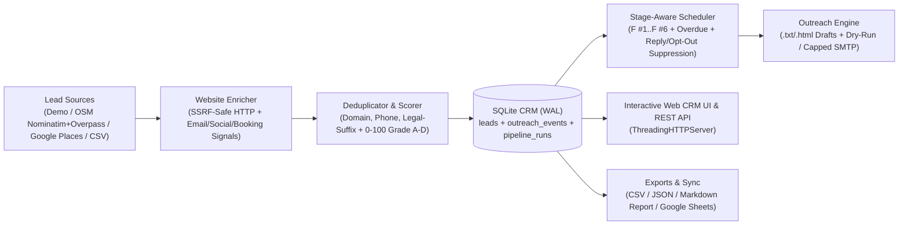

# Lead Finder & Outreach CRM

[](https://www.python.org/)
[-10B981)](#quickstart)
[](#architecture)
[](#license)

A production-ready **B2B Lead Discovery, Website Enrichment, Qualification Scoring, and Multi-Stage Outreach CRM** built in Python.

Designed to run out-of-the-box with zero mandatory third-party core dependencies, it automates the full outbound workflow: discovering local businesses across multiple sources, enriching websites for public contact emails and digital-maturity signals, deduplicating across domains/phones/legal entity names, scoring ICP fit (`A`–`D`), managing a persistent SQLite CRM, computing `F #1`–`F #6` follow-up cadences (`+2, +4, +7, +10, +14, +21` days), rendering personalized drafts, safely dispatching via rate-limited SMTP, syncing Google Sheets, and serving an interactive **Web CRM Dashboard + REST API**.

---

## Architecture



---

## Key Capabilities

| Layer | Capabilities |
| :--- | :--- |
| **Multi-Source Discovery** | **100% Free OpenStreetMap** (`--mode osm`, Nominatim city geocoding + multi-mirror Overpass QL failover + 30 niche mappings or raw `key=value` tags), **Google Places API (New)** (`--mode google`, FieldMask cost control + pagination + closed-business filtering), **Flexible CSV Import** (`--mode csv` with column alias mapping), and **Offline Demo** (`--mode demo`). |
| **SSRF-Safe Website Enrichment** | Concurrent `WebsiteEnricher` inspects business homepages and internal `/contact` or `/about` pages to discover `mailto:`/public emails, social URLs (`LinkedIn`, `Instagram`, `Facebook`, `X`), HTTPS status, CMS (`WordPress`, `Shopify`, `Wix`, `Squarespace`, `Webflow`), booking widgets (`Calendly`, `Acuity`, `Fresha`, `Booksy`, etc.), and live chat widgets. Validates public DNS/IPs on initial requests and redirects. |
| **Multi-Key Deduplication** | Resolves duplicates across normalized root domain, normalized phone digits, canonical business name + city (stripping `LLC`, `Inc.`, `Ltd.`, etc.), and high-confidence fuzzy matching while preserving same-name businesses in distinct cities and backfilling missing fields. |
| **ICP Scoring & Angles** | Deterministic `0–100` score and tier (`A`, `B`, `C`, `D`) combining contactability, rating/review proof, and digital-maturity gaps, generating tailored outreach angles and personalized email hooks. |
| **SQLite CRM & Audit Log** | WAL-mode SQLite database (`output/crm.db`) with schema versioning, lifecycle statuses (`new`, `enriched`, `contacted`, `replied`, `booked`, `won`, `lost`, `unsubscribed`, `bounced`), `outreach_events` audit ledger, and `pipeline_runs` telemetry. |
| **Stage-Aware Follow-Up Sequencer** | Computes `F #1`–`F #6` (`+2, +4, +7, +10, +14, +21` days), catches overdue items without double-queuing multiple stages per lead, skips stages already marked `sent`, and automatically suppresses `replied`, `booked`, `won`, `lost`, `bounced`, and `unsubscribed` leads. |
| **Safe Outreach Engine** | Generates collision-safe `.txt` and `.html` drafts with stage-specific copy (`initial`, `F #1`, `F #2`, `F #3`, `F #6`). Includes header-injection validation, mandatory dry-run defaults, daily send cap (`DAILY_SEND_LIMIT`), inter-send pacing (`SEND_DELAY_SECONDS`), and `List-Unsubscribe` headers across SSL (465) or STARTTLS (587) SMTP. |
| **Web CRM Dashboard & REST API** | Built-in `ThreadingHTTPServer` web console (`python3 main.py dashboard`) with KPI overview, live lead search/filtering, inline status editing, slide-over inspection drawer, daily action queue, live email preview/copy, one-click pipeline runner, and CSV exports. |
| **Observability & Portability** | Rotating JSONL structured logs (`output/logs/crm.jsonl`) with automatic secret redaction, atomic CSV writes, Markdown executive reports, optional multi-tab Google Sheets sync, `Dockerfile`, `docker-compose.yml`, and GitHub Actions CI. |

---

## Integrations & Cost Breakdown

| Purpose | Free Built-In Option | Limits / Notes | Optional Upgrade |
| :--- | :--- | :--- | :--- |
| **Lead Discovery** | OpenStreetMap Nominatim + Overpass (`--mode osm`) | **Free**, zero API keys or billing required; built-in rate limiter (1.1s/host) + mirror failover. | Google Places API (New) (`--mode google`, requires `GOOGLE_PLACES_API_KEY`). |
| **CRM Persistence** | Local SQLite (`output/crm.db`) + CSV/JSON exports | **Free**, zero external database server required. | Live multi-tab **Google Sheets** sync via `gspread` (`--sync-sheets`). |
| **Website Enrichment** | Built-in `WebsiteEnricher` (`--enrich`) | **Free**, stdlib HTML parser + SSRF guard + concurrent pool. | Custom enrichment hooks via `EnrichmentSignals`. |
| **Email Drafting & Sending** | Local `.txt`/`.html` drafts + SMTP (`send --confirm-send`) | **Free** with Gmail App Password or any standard SMTP host. | Transactional APIs (Resend/Postmark) for high-volume domains. |

---

## Quickstart

### 1. Run Offline Demo Pipeline (Zero Setup)

```bash
python3 main.py --mode demo --date 2026-11-20 --draft-emails --write-html
```

Inspect generated outputs in `output/`:
- `output/crm.db` — persistent SQLite CRM database
- `output/leads_updated.csv` — canonical 18-column deduplicated sheet
- `output/leads_enriched_crm.csv` — extended export with `CRM Status`, `Lead Score`, `Lead Grade`, and `Outreach Angle`
- `output/followups_today.csv` — prioritized daily + overdue follow-up queue
- `output/email_drafts/` — personalized `.txt` and `.html` outreach drafts
- `output/pipeline_report.md` — Markdown executive run summary

### 2. Run Live Lead Discovery + Website Enrichment (100% Free API)

```bash
python3 main.py run --mode osm --city "Austin" --niche "dentist" --limit 15 --enrich --include-initial --draft-emails
```

Supports 30 built-in niches (`dentist`, `clinic`, `restaurant`, `cafe`, `bakery`, `gym`, `salon`, `plumber`, `electrician`, `real_estate`, `lawyer`, `accounting`, `hotel`, etc.) or raw OpenStreetMap tags:

```bash
python3 main.py run --mode osm --city "Chicago" --niche "shop=florist" --limit 20 --enrich
```

### 3. Launch the Interactive Web CRM Dashboard

```bash
python3 main.py dashboard --host 127.0.0.1 --port 8000
```

Open `http://127.0.0.1:8000` in your browser to filter leads, inspect website maturity signals, preview/copy stage emails, update CRM statuses, run discovery pipelines, and download CSV exports.

### 4. Optional Integrations (Google Sheets, `.env`, Editable CLI Install)

```bash
python3 -m venv .venv
source .venv/bin/activate
pip install -e ".[integrations,dev]"
cp .env.example .env
```

After setting `GOOGLE_SHEET_ID` and placing your Google Cloud Service Account `credentials.json` in the project root:

```bash
python3 main.py run --mode osm --city "Austin" --niche "cafe" --sync-sheets
```

### 5. Docker Deployment

```bash
docker compose up --build -d
```

The dashboard will be available at `http://localhost:8000` with persistent state stored in `./output`.

---

## CLI Reference

Backward-compatible direct flags (`python3 main.py --mode demo ...`) automatically route to `run`, or you can invoke subcommands explicitly (or via `lead-crm` if installed):

| Command | Description | Example |
| :--- | :--- | :--- |
| `run` | Execute discovery, enrichment, dedup, scoring, scheduling, drafting, and exports. | `python3 main.py run --mode osm --city "Austin" --niche "gym" --enrich --draft-emails` |
| `enrich` | Inspect websites of persisted leads lacking enrichment signals. | `python3 main.py enrich --limit 30` |
| `queue` | Display and export today's + overdue follow-up queue. | `python3 main.py queue --date 2026-11-20 --include-initial --draft-emails` |
| `send` | Dry-run preview (default) or live SMTP dispatch with daily send caps. | `python3 main.py send --limit 10` (add `--confirm-send` to transmit) |
| `lead-update` | Update a lead's CRM status, email, owner, outreach date, or notes. | `python3 main.py lead-update --id 1 --status replied --notes "Booked call"` |
| `stats` | Display CRM funnel analytics, email coverage, and score distribution. | `python3 main.py stats` |
| `export` | Export persisted leads to `csv`, `extended-csv`, or `json`. | `python3 main.py export --format extended-csv --out output/crm_export.csv` |
| `sync` | Push leads, daily queue, and metrics tabs to Google Sheets. | `python3 main.py sync` |
| `dashboard` | Start the interactive Web CRM Dashboard and REST API server. | `python3 main.py dashboard --port 8000` |

---

## REST API Endpoints

When running `python3 main.py dashboard`, the following JSON/CSV endpoints are exposed:

| Method & Path | Purpose |
| :--- | :--- |
| `GET /api/health` | Service health and active SQLite database path. |
| `GET /api/analytics` | Funnel counts, email coverage %, average score, grade distribution, and recent pipeline runs. |
| `GET /api/leads` | Filterable lead list (`?status=&grade=&city=&niche=&search=`). |
| `POST /api/leads` | Manually add and score a lead. |
| `GET /api/leads/{id}` | Detailed lead record, enrichment signals, and outreach audit timeline. |
| `PATCH /api/leads/{id}` | Update status, notes, owner, email, or outreach date (recalculates follow-ups and score). |
| `DELETE /api/leads/{id}` | Remove a lead from the CRM. |
| `GET /api/leads/{id}/preview-email?stage=initial` | Render personalized subject, plaintext, and HTML email preview. |
| `POST /api/leads/{id}/mark-sent` | Log an outreach stage as sent, schedule `F #1`–`F #6` if `initial`, and update status. |
| `GET /api/queue?date=YYYY-MM-DD&include_initial=false` | Retrieve due + overdue action queue items. |
| `POST /api/pipeline/run` | Trigger a full discovery/enrichment/drafting run asynchronously from the UI. |
| `GET /api/export/csv?kind=master\|extended\|queue` | Download CSV exports directly. |

---

## Configuration & Environment Variables

See [`.env.example`](.env.example) and [`config.py`](config.py) for all tunable parameters:

| Variable | Default | Description |
| :--- | :--- | :--- |
| `SENDER_NAME` | `Your Name` | Sender signature name in rendered emails. |
| `SENDER_COMPANY` | `""` | Optional company name in email signature. |
| `SENDER_TITLE` | `""` | Optional role/title in email signature. |
| `CRM_DB_PATH` | `output/crm.db` | SQLite database file path. |
| `LOG_LEVEL` | `INFO` | Logging verbosity (`DEBUG`, `INFO`, `WARNING`, `ERROR`). |
| `GOOGLE_SHEET_ID` | `""` | Target Google Spreadsheet ID for `--sync-sheets`. |
| `GOOGLE_CREDENTIALS_PATH` | `credentials.json` | Google Cloud Service Account JSON path. |
| `GOOGLE_PLACES_API_KEY` | `""` | API key required only for `--mode google`. |
| `SMTP_HOST` / `SMTP_PORT` | `smtp.gmail.com` / `465` | Outbound SMTP host and port (SSL on `465` or STARTTLS on `587`). |
| `GMAIL_ADDRESS` / `GMAIL_APP_PASSWORD` | `""` | Gmail SMTP credentials (or use generic `SMTP_USER` / `SMTP_PASSWORD`). |
| `DAILY_SEND_LIMIT` | `25` | Hard cap on emails dispatched per day. |
| `SEND_DELAY_SECONDS` | `3.0` | Inter-message pacing interval between live SMTP sends. |
| `ENRICH_MAX_WORKERS` | `4` | Concurrent worker threads for website enrichment. |
| `ENRICH_TIMEOUT_SECONDS` | `10` | Per-request timeout during website enrichment. |

---

## Project Structure

```text
lead-finder-outreach-crm/
├── config.py                     # Schemas, follow-up cadence, OSM tags, scoring weights, email templates
├── main.py                       # Unified CLI & backward-compatible runner
├── pyproject.toml                # Package metadata, console script (`lead-crm`), pytest & ruff config
├── requirements.txt              # Optional integration dependencies (dotenv, gspread, google-auth)
├── Dockerfile                    # Production container image (non-root user + healthcheck)
├── docker-compose.yml            # Local container orchestration with persistent ./output volume
├── .github/workflows/ci.yml      # GitHub Actions CI matrix (Python 3.11–3.13, ruff, pytest, smoke run)
├── .env.example                  # Safe environment configuration template
├── LEARNING_GUIDE.md             # Architectural walkthrough and customization cookbook
├── sample_data/                  # Anonymized CSV and mock API JSON fixtures
├── src/
│   ├── models.py                 # Typed dataclasses (LeadRecord, EnrichmentSignals, OutreachEvent, etc.)
│   ├── logging_config.py         # Secret-scrubbing console & rotating JSONL logging
│   ├── http_client.py            # Rate-limited HTTP client with retries, backoff, and SSRF protection
│   ├── lead_finder.py            # Demo, OSM (Nominatim+Overpass), Google Places, and CSV importers
│   ├── enricher.py               # Concurrent website contact & digital-maturity signal extractor
│   ├── scorer.py                 # Weighted 0–100 ICP lead scoring & personalized outreach hooks
│   ├── sheet_manager.py          # Atomic CSV/JSON I/O, multi-key deduplication & Google Sheets sync
│   ├── repository.py             # Thread-safe SQLite WAL CRM repository & funnel analytics
│   ├── followup_scheduler.py     # F #1..F #6 date math, overdue catch-up & opt-out suppression
│   ├── email_drafter.py          # Multi-stage renderer, validation, draft writer & safe SMTP sender
│   ├── pipeline.py               # End-to-end orchestrator shared by CLI and Web UI
│   ├── web_app.py                # REST API & SPA static server (ThreadingHTTPServer)
│   └── static/                   # Responsive dark-mode CRM Web UI (index.html, styles.css, app.js)
└── tests/
    ├── test_pipeline.py          # End-to-end demo CSV pipeline regression test
    ├── test_crm_and_scoring.py   # Multi-key dedup, scoring, SQLite repository & SMTP cap tests
    ├── test_enricher_and_http.py # SSRF guards, HTML enrichment & mocked OSM/Google API tests
    └── test_web_and_cli.py       # REST API lifecycle & CLI subcommand integration tests
```

---

## Testing & Quality Assurance

Run the full automated unit and integration test suite:

```bash
python3 -m unittest discover -s tests -v
# or with pytest
pytest
```

Verify syntax and run an end-to-end CLI smoke check:

```bash
python3 -m compileall -q src tests main.py config.py
python3 main.py --mode demo --date 2026-11-20 --draft-emails
python3 main.py stats
```

---

## Security & Responsible Automation Guardrails

- **SSRF Protection:** Website enrichment blocks `localhost`, private RFC-1918 networks, link-local metadata endpoints (`169.254.169.254`), non-HTTP schemes, and unsafe HTTP redirects.
- **Email Safety:** Rejects malformed addresses and CRLF header-injection payloads; enforces dry-run defaults, daily send limits, `List-Unsubscribe` headers, and automatic suppression for replied or opted-out contacts.
- **Secret Redaction:** Rotating JSONL logs scrub API keys, bearer tokens, and passwords automatically.

---

## License

Released under the [MIT License](pyproject.toml).
# lead-finder-outreach-crm
# lead-finder-outreach-crm
